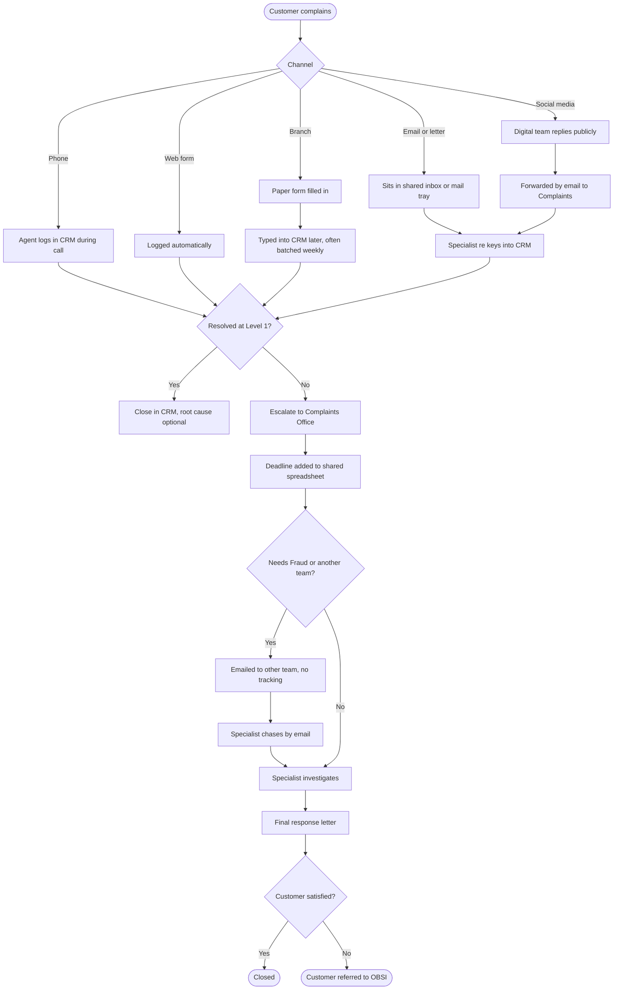

# Current State Process (As Is)
## Complaint Management Process Redesign

Agreed at the current state workshop (E11), February 24, 2025.

## Pain points

| # | Pain point | Step | Evidence |
|---|---|---|---|
| PP1 | Branch, email and letter complaints logged days late | E1, F1 | Q3: 3.3 to 6.4 days average |
| PP2 | Some branch complaints resolved on the spot are never logged | E | E02, E06 interviews |
| PP3 | Acknowledgement depends on manual effort | All manual channels | Q4: letters 0%, email 11.6% within 2 days |
| PP4 | Deadlines tracked in a spreadsheet with no warnings | K | E03, E04 |
| PP5 | Hand offs to Fraud and other teams have no tracking | M, N | Fraud: 18.8% over 56 days |
| PP6 | Root cause optional on closure | I | Q11: 5.8% missing |
| PP7 | Social media and email complaints duplicated | G1, F1 | Q12: 53 possible pairs |
| PP8 | Customer not updated during investigation | O | E13 customer review |

## Measures at baseline (2024)

| Measure | Value |
|---|---|
| Logged within 1 day | 63.5% |
| Acknowledged within 2 days | 62.8% |
| Closed within 56 days | 92.0% |
| Records with root cause | 94.2% |
| Specialist time re keying per case | about 25 minutes |
