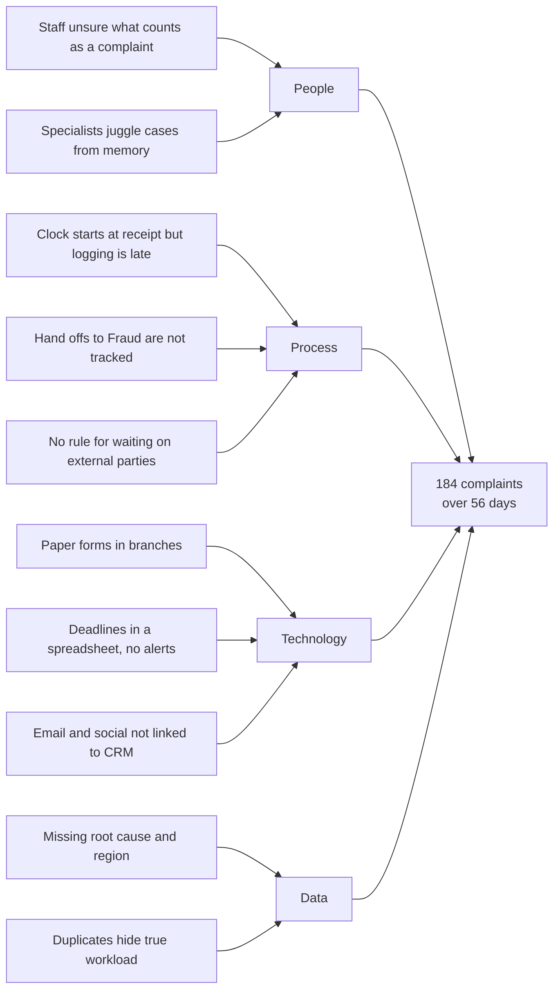

# Root Cause Analysis
## Complaint Management Process Redesign

Root cause workshop (E12), February 26, 2025. Two problems were analyzed: why complaints miss the 56 day deadline, and why fee complaints keep recurring.

## Problem 1: 184 complaints closed after 56 days in 2024

### Fishbone (cause and effect)

### 5 Whys

| Why? | Answer |
|---|---|
| 1. Why did 184 complaints take longer than 56 days? | All were escalated, and escalated cases ran out of time. |
| 2. Why did escalated cases run out of time? | Specialists did not see a case was close to breaching until too late. |
| 3. Why did they not see it? | Deadlines were tracked by hand in a spreadsheet, counted from the logged date rather than the received date. |
| 4. Why from the logged date? | The CRM had no "received date" field, and many complaints arrived days before they were logged. |
| 5. Why were they logged late? | Branch, email, letter and social complaints have no direct capture into the CRM, so they wait for someone to re key them. |

**Root cause:** no single point of capture and no system controlled deadline based on the date received.

## Problem 2: 501 complaints from three fee issues

| Why? | Answer |
|---|---|
| 1. Why do fee complaints keep happening? | Customers are surprised by fees, some are charged in error, and reversals are refused inconsistently. |
| 2. Why are customers surprised? | Fee disclosure for overdraft and e-Transfer fees is buried in account agreements. |
| 3. Why are some charged in error? | A fee rule fires on accounts that should be exempt (for example, some seniors' accounts). |
| 4. Why are reversals inconsistent? | No guideline for when staff can reverse a fee. |
| 5. Why was this not fixed sooner? | Complaint root cause data was incomplete and never reported to product owners. |

**Root cause:** complaint insight does not flow back to the people who own fees and products.

## Root causes and where they are addressed

| Root cause | Addressed by |
|---|---|
| No single point of capture | BR01, BR02 in the [BRD](../03_analysis/business_requirements_document.md) |
| No system controlled deadline from received date | BR04, BR05 |
| Untracked hand offs | BR06 |
| Unclear complaint definition | BR11 (procedure and training) |
| Insight not reaching product owners | BR09, BR10 |

Fee disclosure wording, the exemption rule error and reversal guidelines were passed to the fee product owner as separate actions outside this project's scope.
