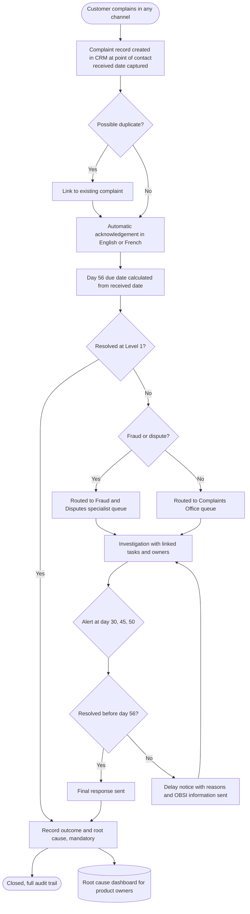

# Future State Process (To Be)
## Complaint Management Process Redesign

Agreed with the Complaints Office, frontline leads, Compliance and IT, March 2025. Editable version: [diagrams/future_state_complaints.drawio](diagrams/future_state_complaints.drawio) (open at app.diagrams.net).

## What changed and why

| Step | Change | Pain point solved |
|---|---|---|
| Capture | Every channel creates a CRM record at the point of contact | PP1, PP2 |
| Received date | Separate from logged date; drives the clock | PP1 |
| Duplicate check | Flags likely duplicates | PP7 |
| Acknowledgement | Automatic in all channels | PP3, PP8 |
| Due date and alerts | System calculated, with warnings | PP4 |
| Routing | Fraud and disputes to a specialist queue | PP5 |
| Linked tasks | Hand offs tracked with owners | PP5 |
| Delay notice | Generated before day 56 | PP4 |
| Closure | Root cause mandatory | PP6 |
| Dashboard | Insight to product owners | Problem 2 root cause |

## Controls in the new process

| Control | Type | Prevents |
|---|---|---|
| Received date mandatory and cannot be later than logged date | Preventive | Clock manipulation or errors |
| Automatic acknowledgement | Preventive | Customers left without contact |
| Day 30, 45, 50 alerts | Detective | Missed deadlines |
| Root cause mandatory on closure | Preventive | Gaps in trend data |
| Every status change logged | Detective | Undocumented decisions |
