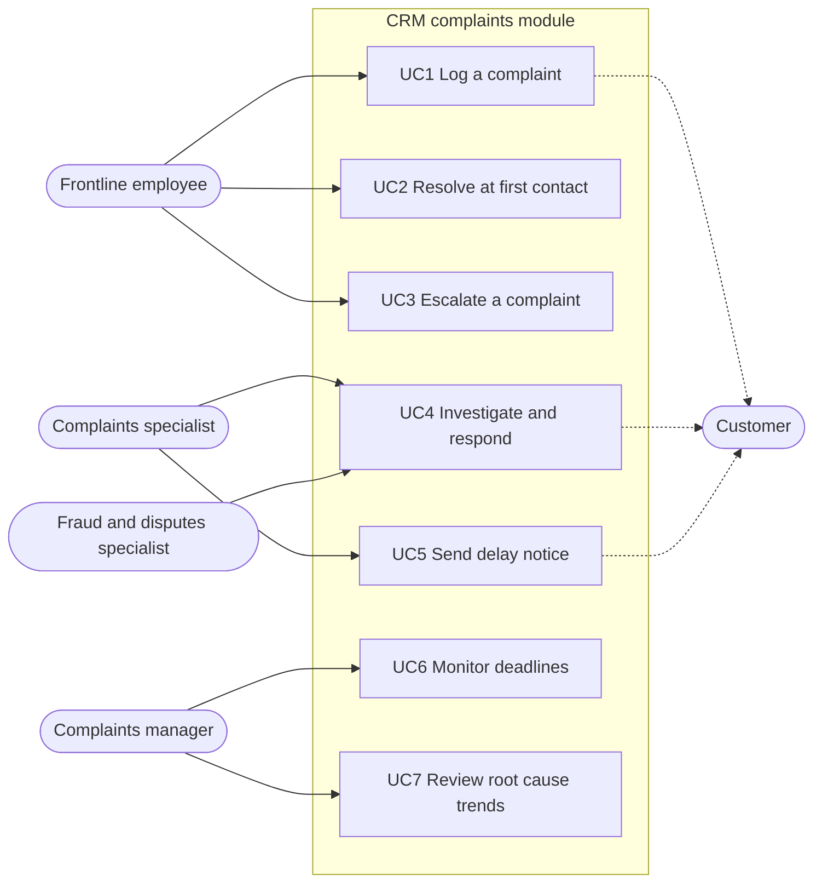

# Use Cases
## Complaint Management Process Redesign

## Actors

| Actor | Description |
|---|---|
| Frontline employee | Branch staff, contact centre agent or digital team member who first receives a complaint |
| Complaints specialist | Complaints Office handler for escalated complaints |
| Fraud and disputes specialist | Handles routed fraud and dispute complaints |
| Complaints manager | Supervises the Complaints Office |
| Customer | Person making the complaint |
| CRM system | The complaints module |

## Use case diagram

## UC1: Log a complaint

| Item | Detail |
|---|---|
| Primary actor | Frontline employee |
| Goal | Record a complaint at the point of contact |
| Trigger | A customer expresses dissatisfaction in any channel |
| Preconditions | Employee is signed in to the CRM; customer is identified |
| Requirements | BR01, BR02, BR03, BR08, BR11 |

**Main flow**
1. Employee opens "New complaint" from the customer's profile.
2. System pre fills customer details and the channel.
3. Employee enters the received date (defaults to today), category, description and the customer's preferred language and contact method.
4. System checks for possible duplicates and shows none.
5. Employee saves the complaint.
6. System creates a complaint ID, calculates the day 56 due date and sends an acknowledgement to the customer.

**Alternative flows**
* **4a. Possible duplicate found:** system shows matching complaints; employee links the new record to the existing one or confirms it is a new complaint.
* **3a. Complaint received by letter or email days earlier:** employee enters the actual received date; system calculates the due date from it.

**Exception flows**
* **3b. Received date later than today:** system blocks save and shows "Received date cannot be in the future."

**Postconditions:** complaint recorded, due date set, acknowledgement sent and logged.

## UC2: Resolve at first contact

| Item | Detail |
|---|---|
| Primary actor | Frontline employee |
| Goal | Record and close a complaint resolved during the first conversation |
| Requirements | BR01, BR09, BR11 |

**Main flow**
1. Employee logs the complaint (UC1).
2. Employee resolves the issue with the customer and selects "Resolved at first contact."
3. Employee records the outcome and root cause.
4. System closes the complaint and logs every step.

**Postconditions:** even complaints resolved on the spot are on record, which the CCO confirmed is required (RULE01).

## UC3: Escalate a complaint

| Item | Detail |
|---|---|
| Primary actor | Frontline employee |
| Goal | Pass an unresolved complaint to the right specialist team |
| Requirements | BR06, BR07 |

**Main flow**
1. Employee selects "Escalate" and records what has been tried.
2. System routes the complaint: fraud and dispute categories to the Fraud and Disputes queue, all others to the Complaints Office queue.
3. System notifies the receiving queue and updates the customer.

**Postconditions:** complaint in the right queue with full history; due date unchanged.

## UC4: Investigate and respond

| Item | Detail |
|---|---|
| Primary actor | Complaints specialist or Fraud and disputes specialist |
| Goal | Investigate and send a final response before day 56 |
| Requirements | BR04, BR06, BR09, BR12 |

**Main flow**
1. Specialist takes the complaint from the queue.
2. Specialist creates linked tasks for other teams if needed, each with an owner and due date.
3. Specialist records findings and the outcome (upheld, partially upheld, not upheld) and any compensation.
4. Specialist selects a root cause from the controlled list.
5. System generates the final response letter in the customer's language; specialist reviews and sends.
6. System closes the complaint and logs every step.

**Alternative flows**
* **2a. Waiting on an external party** (for example, a card network): task status set to "Waiting on external party" with the expected date.
* **4a. No root cause selected:** system blocks closure.

## UC5: Send delay notice

| Item | Detail |
|---|---|
| Primary actor | Complaints specialist |
| Trigger | Day 50 warning on an open complaint |
| Requirements | BR05 |

**Main flow**
1. Specialist receives the day 50 warning.
2. Specialist confirms the complaint cannot be resolved by day 56 and records the reason.
3. System generates the delay notice with the reason and OBSI contact information.
4. Specialist sends it; system logs the date sent.

**Exception:** if no delay notice or final response has been sent by day 55, the system escalates to the complaints manager.

## UC6: Monitor deadlines

Complaints manager uses the deadline dashboard to see open complaints by age band (0 to 29, 30 to 44, 45 to 49, 50 to 56, over 56 days), by owner and by category, and reassigns work. Requirements: BR04, BR12.

## UC7: Review root cause trends

Complaints manager and product owners review the monthly root cause dashboard, agree actions, and record them. Requirements: BR10.
