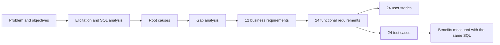

# Complaint Management Process Redesign: Business Analysis Project

**Portfolio project by Blessing Adeniyi, PMP · Role: Business Analyst**

> This is a simulated project built for my professional portfolio. Maple Prairie Bank is a fictional federally regulated bank, and all names and data are invented, including the complaint dataset. The project shows the full business analysis lifecycle, from a vague problem to tested, traceable requirements and measured benefits.

## The problem

An internal audit found Maple Prairie Bank's complaint process inconsistent. Complaints arrived through six channels, some were logged days late, escalated complaints missed the 56 day final response requirement under the Financial Consumer Protection Framework, and root cause data was too incomplete to stop repeat problems.

## What the analysis found (SQL on 2,440 complaints)

* **92.0%** of closed complaints met the 56 day deadline, and **all 184 breaches were escalated cases**
* Branch, email and letter complaints were logged **3.3 to 6.4 days late** on average
* Only **62.8%** were acknowledged within 2 days (letters 0%, email 11.6%)
* **Three fee issues caused 20.5%** of all complaints
* **5.8%** of records had no root cause, and **53** possible duplicate pairs existed

## Results after go live (Q4 2025)

| Measure | Before | After |
|---|---|---|
| Closed within 56 days | 92.0% | **99.6%** |
| Acknowledged within 2 days | 62.8% | **98.9%** |
| Logged within 1 day | 63.5% | **97.4%** |
| Records with root cause | 94.2% | **100%** |
| Top 3 fee complaints (Q4 vs Q4) | 123 | **84** |

## Try the data analysis yourself

```bash
cd 02_elicitation/data_analysis
python run_analysis.py
```

This loads [complaints_2024.csv](02_elicitation/data_analysis/complaints_2024.csv) into SQLite and runs the 15 queries in [analysis.sql](02_elicitation/data_analysis/analysis.sql). Results: [query_results.md](02_elicitation/data_analysis/query_results.md).

## Documents

| Phase | Documents |
|---|---|
| **1. Initiation** | [Project brief](01_initiation/project_brief.md) · [Stakeholder analysis](01_initiation/stakeholder_analysis.md) · [BA approach plan](01_initiation/ba_approach_plan.md) |
| **2. Elicitation** | [Elicitation log](02_elicitation/elicitation_log.md) · [Current state process](02_elicitation/current_state_process.md) · [Data analysis findings](02_elicitation/data_analysis/data_analysis_findings.md) · [Root cause analysis](02_elicitation/root_cause_analysis.md) |
| **3. Analysis** | [Gap analysis](03_analysis/gap_analysis.md) · [Future state process](03_analysis/future_state_process.md) · [draw.io source](03_analysis/diagrams/future_state_complaints.drawio) · [Business requirements document](03_analysis/business_requirements_document.md) · [Use cases](03_analysis/use_cases.md) |
| **4. Requirements** | [Functional requirements](04_requirements/functional_requirements.md) · [User stories](04_requirements/user_stories.md) · [Jira import CSV](04_requirements/jira_backlog_import.csv) · [Data dictionary](04_requirements/data_dictionary.md) · [Traceability matrix](04_requirements/requirements_traceability_matrix.md) |
| **5. Validation** | [UAT plan and results](05_validation/uat_plan_and_results.md) · [Benefits tracking](05_validation/benefits_tracking.md) · [Lessons learned](05_validation/lessons_learned.md) |

## How the pieces connect



## Skills demonstrated

* Elicitation: interviews, observation, workshops, survey, document analysis
* Data analysis: SQL (SQLite), Python, data quality assessment
* Process modelling: current and future state, draw.io and Mermaid
* Root cause analysis: fishbone and 5 Whys
* Requirements: BRD, MoSCoW, use cases, functional and non functional requirements, user stories, Gherkin, data dictionary
* Traceability, UAT and benefits realization
* Compliance awareness: federal complaint handling requirements, OBSI, privacy, audit trail
* Tools: Jira, Confluence, draw.io, SQL, Python, Excel
